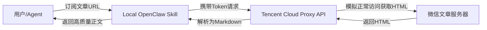

# WeChat2MD: 微信公众号文章解析方案 (Cloud Proxy + OpenClaw Skill)

这是一个专为 AI Agent（特别是 **小龙虾 OpenClaw**）设计的平衡方案，用于绕过微信公众号文章极其严苛的反爬机制。

## 核心架构

由于微信文章在非腾讯云/特殊环境下通过常规爬虫读取极易触发反爬重定向（例如跳转到验证码或“只能在微信客户端查看”），本项目采用了 **“云端解析中转 + 本地 Agent 技能调用”** 的架构。



---

## 路线图：Step by Step 部署与使用

### 第一步：部署云端解析中转 (Cloud Proxy)

**为什么必须是腾讯云？** 微信文章在腾讯云 IDC 机房的出口 IP 下通常不会触发严苛的反爬，解析成功率接近 100%。

1. **服务器准备**：
   - 准备一台腾讯云服务器（轻量应用服务器即可），系统推荐 **Ubuntu 20.04+**。
   - 在控制台防火墙中放通 **8001** 端口。

2. **一键环境配置**：
   参照 [deploy_tencent_cloud.md](./deploy_tencent_cloud.md) 中的说明，配置 Docker 镜像加速器。

3. **启动服务**：
   ```bash
   mkdir -p /opt/wechat2md && cd /opt/wechat2md
   # 克隆代码 (建议使用 GitHub 代理加速)
   git clone https://ghp.ci/https://github.com/raphaelxiao/wechat2md.git .
   
   # 生成随机 Token 并写入 .env
   TOKEN=$(python3 -c "import secrets; import string; print(''.join(secrets.choice(string.ascii_letters + string.digits) for _ in range(32)))")
   echo "API_TOKEN=$TOKEN" > .env
   echo "生成的 Token 为: $TOKEN (请记录下来，下一步要用到)"

   # 启动
   sudo docker compose up -d
   ```

---

## 第二步：在 小龙虾 OpenClaw 中安装技能 (Agent Skill)

1. **放置技能文件夹**：
   将项目中的 `wechat-article-fetcher/wechat-article-fetcher` 文件夹整体复制到你的 OpenClaw 的 `skills` 目录下。

2. **配置认证信息**：
   在技能目录中（`skills/wechat-article-fetcher/`），将 `.env.example` 复制为 `.env` 并编辑：
   ```ini
   # 填入第一步中生成的 Token
   WECHAT2MD_TOKEN=你的Token
   # 填入你服务器的公网 IP 和端口
   WECHAT2MD_URL=http://你的服务器IP:8001/api/v1/wechat2md
   ```

3. **激活技能**：
   重启 OpenClaw 或在其 UI/控制台加载新技能。Agent 现在具备了 `wechat-article-fetcher` 能力。

---

## 第三步：使用方法

你可以直接在 OpenClaw 中发送：
> “这篇文章讲了什么：https://mp.weixin.qq.com/s/xxxxxxxx”

**Agent 会自动执行以下逻辑：**
1. 识别出链接符合微信特征。
2. 触发 `wechat-article-fetcher` 技能。
3. 调用本地 `scripts/wechat_fetcher.py` 脚本发送请求。
4. 获得精准的 Markdown 内容并进行分析总结。

---

## 项目结构
- `/`：云端服务端代码 (FastAPI + Docker)。
- `/wechat-article-fetcher/`：专为 OpenClaw 准备的技能插件包。
- `deploy_tencent_cloud.md`：腾讯云环境下的特殊配置说明（包含各种国内网络问题解决方案）。

## 许可证
MIT
